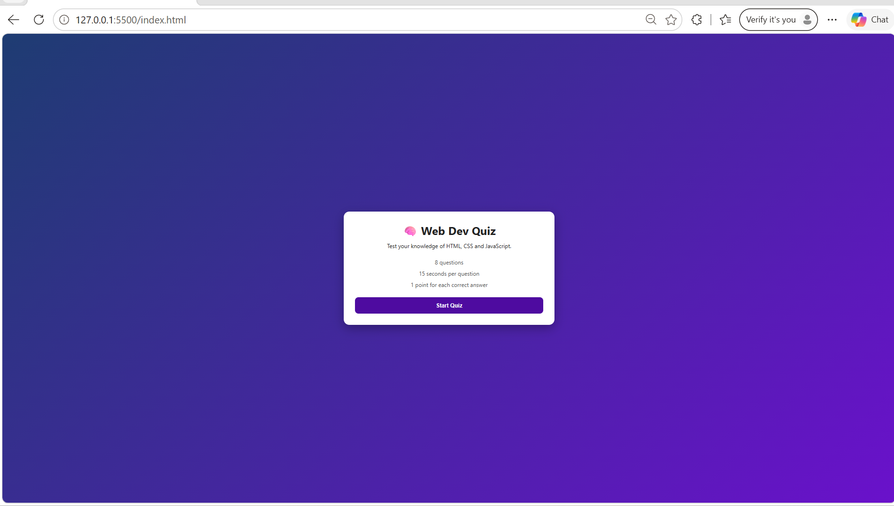

# 🧠 Frontend Quiz App

An interactive quiz app built with **HTML, CSS and JavaScript**. Answer timed multiple-choice questions on web development and see your score at the end.



## About

This project shows core front-end skills in one app: structuring a page with HTML, styling it with CSS, and adding logic with JavaScript. The quiz has 8 questions on HTML, CSS and JavaScript.

## Features

- Start, quiz and result screens
- 15-second countdown timer for each question
- Timer turns red in the last 5 seconds
- Instant feedback: correct answers turn green, wrong ones turn red
- Correct answer is always revealed after answering or when time runs out
- Progress bar and question counter
- Final score with a message based on performance
- Restart button to play again
- Responsive design for mobile and desktop

## Tech Used

- **HTML5**: semantic structure and screens
- **CSS3**: Flexbox, gradients, animations, media queries
- **JavaScript (ES6)**: DOM manipulation, event listeners, timers (`setInterval`), dynamic rendering

## Project Structure

```
frontend-quiz-app/
├── index.html
├── README.md
├── screenshot.png
├── css/
│   └── style.css
└── js/
    └── script.js
```

## How to Run Locally

1. Open the folder in VS Code.
2. Right-click `index.html` and choose **Open with Live Server**, or double-click `index.html` to open it in your browser.

## What I Learned

- Switching between multiple screens using JavaScript and CSS classes
- Building a countdown timer with `setInterval` and `clearInterval`
- Creating elements dynamically from a data array
- Managing app state (current question, score, time left)
- Making a layout responsive with media queries

## Future Improvements

- Shuffle questions on every attempt
- Save the high score using `localStorage`
- Add quiz categories (HTML, CSS, JavaScript)
- Fetch questions from an API such as Open Trivia DB
- Add sound effects and a dark mode

